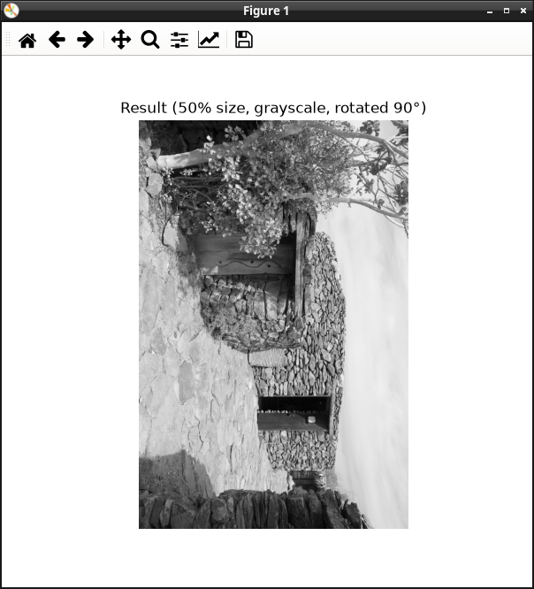
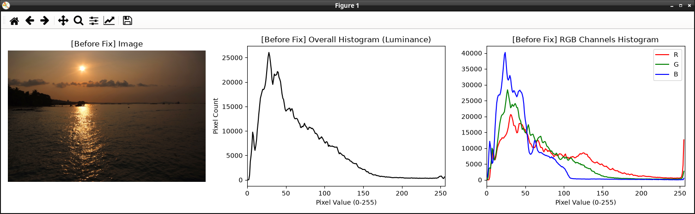
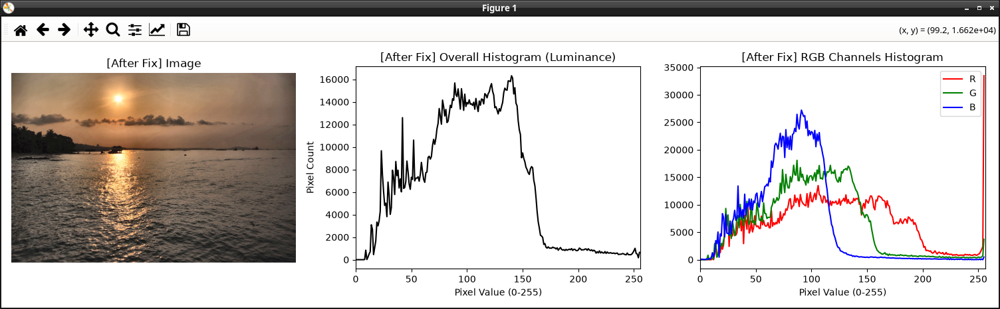

# Computer Graphics – Task 1

Skrypt w języku python realizujący podstawowe operacje na obrazach rastrowych przy użyciu bibliotek **OpenCV (`cv2`)**, **NumPy** oraz **Matplotlib**.

## Jak uruchomić program

1. Aktywuj środowisko wirtualne i zainstaluj wymagane biblioteki:
   ```bash
   python3 -m venv .venv
   source .venv/bin/activate
   pip install opencv-python matplotlib numpy PyQt6
   ```

2. Uruchom skrypt z głównego katalogu repozytorium:
   ```bash
   python task1/task1.py
   ```

## Wyniki działania programu

W folderze `task1/` znajdują się zrzuty ekranu przedstawiające wyniki działania skryptu:

### Oryginalny obraz


### Obraz wynikowy
*(zmniejszony o 50%, skala szarości, obrót o 90°)*




---

# Computer Graphics – Task 2

Skrypt w języku Python analizujący jakość zdalnie pobranego zdjęcia na podstawie statystyk jego histogramu oraz automatycznie poprawiający ekspozycję i kontrast w przypadku wykrycia wad (bonus).

## Jak uruchomić program

```bash
python task2/task2.py
 ```

## Wyniki działania programu


