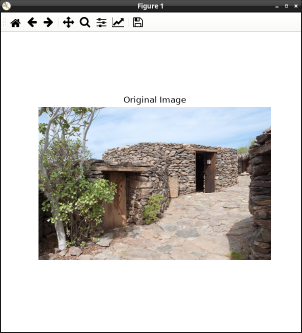

# Computer Graphics – Task 1

Skrypt w języku python realizujący podstawowe operacje na obrazach rastrowych przy użyciu bibliotek **OpenCV (`cv2`)**, **NumPy** oraz **Matplotlib**.

## Jak uruchomić program

1. Aktywuj środowisko wirtualne i zainstaluj wymagane biblioteki:
   ```bash
   python3 -m venv .venv
   source .venv/bin/activate
   pip install opencv-python matplotlib numpy PyQt6
   ```

2. Uruchom skrypt z głównego katalogu repozytorium:
   ```bash
   python task1/task1.py
   ```

## Wyniki działania programu

W folderze `task1/` znajdują się zrzuty ekranu przedstawiające wyniki działania skryptu:

### Oryginalny obraz


### Obraz wynikowy
*(zmniejszony o 50%, skala szarości, obrót o 90°)*


---

# Computer Graphics – Task 2

Skrypt w języku Python analizujący jakość zdalnie pobranego zdjęcia na podstawie statystyk jego histogramu oraz automatycznie poprawiający ekspozycję i kontrast w przypadku wykrycia wad (bonus).

## Jak uruchomić program

```bash
python task2/task2.py
```

## Wyniki działania programu


---

# Computer Graphics – Task 3

Skrypt w języku Python automatycznie zliczający powtórzenia ćwiczeń (**squat** oraz **bicep curl**) na nagraniach wideo przy użyciu wstępnego przetwarzania klatek (rozmycie Gaussa + CLAHE) oraz modelu detekcji pozy **YOLOv8-Pose**.

## Jak uruchomić program

1. Zainstaluj wymaganą bibliotekę **Ultralytics** (w aktywnym środowisku `.venv`):
   ```bash
   pip install ultralytics
   ```

2. W pliku task3/task3.py (w sekcji if __name__ == "__main__":) skonfigurowano analizę obu ćwiczeń sekwencyjnie (możesz zakomentować wybrane wywołanie, aby uruchomić tylko jedno z nich):
   ```python
   # Dla przysiadów (squat):
   run_rep_counter("squat", "squat_sample.mp4", "output_squat.mp4", pose_model)

   # Lub dla uginania ramion (bicep curl):
   run_rep_counter("bicep_curl", "bicep_curl_sample.mp4", "output_bicep_curl.mp4", pose_model)
   ```

3. Uruchom skrypt z poziomu głównego katalogu projektu:
   ```bash
   python task3/task3.py
   ```
   *(Podczas odtwarzania wideo możesz wcisnąć klawisz `q`, aby przerwać działanie programu).*

## Wyniki i nagrania wyjściowe

Po przetworzeniu wideo skrypt generuje pliki wideo z nałożonym szkieletem kluczowych punktów ciała (keypoints), zmierzonym kątem w stawie oraz licznikiem powtórzeń (HUD).

Pliki wynikowe zapisywane są bezpośrednio w katalogu **`task3/`**:
- **`task3/output_squat.mp4`** – wynik analizy ćwiczenia przysiadów (*squat*).
- **`task3/output_bicep_curl.mp4`** – wynik analizy ćwiczenia uginania przedramion (*bicep curl*).
